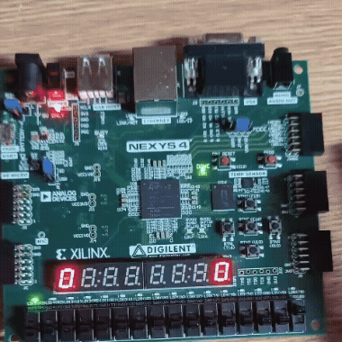
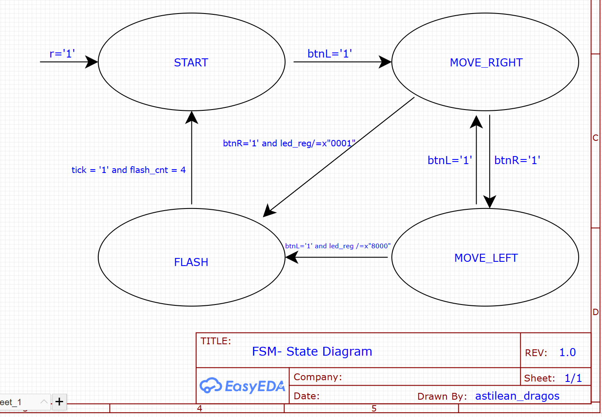

# FPGA 1D Ping Pong Game

A hardware implementation of a 1D Ping Pong game on an FPGA board, featuring real-time score tracking and state-machine-based game logic.

## Gameplay Demo
*Watch the 1D Ping Pong game in action on the Nexys 4 board:*  

## Tech Stack
- **Language:** VHDL
- **Hardware:** Digilent Nexys 4 (Artix-7) 
- **Tools:** Xilinx Vivado

## Hardware Architecture & Features
- **Game Logic FSM:** Implements state transitions (`START`, `MOVE_RIGHT`, `MOVE_LEFT`, `FLASH`) to control the ball's movement and detect faults.
- **Custom Clock Divider:** Scales down the system clock to create a playable refresh rate for the LEDs.
- **Seven-Segment Multiplexing:** Dynamically displays Player 1 and Player 2 scores using a refresh counter and anode switching.

### FSM State Diagram
*The logic flow detailing the transitions for ball movement and fault detection:*  

## How to Run
1. Open Xilinx Vivado and create a new RTL project.
2. Import the `.vhd` source files and the corresponding `.xdc` constraints file.
3. Run Synthesis, Implementation, and generate the Bitstream.
4. Program the FPGA board.
